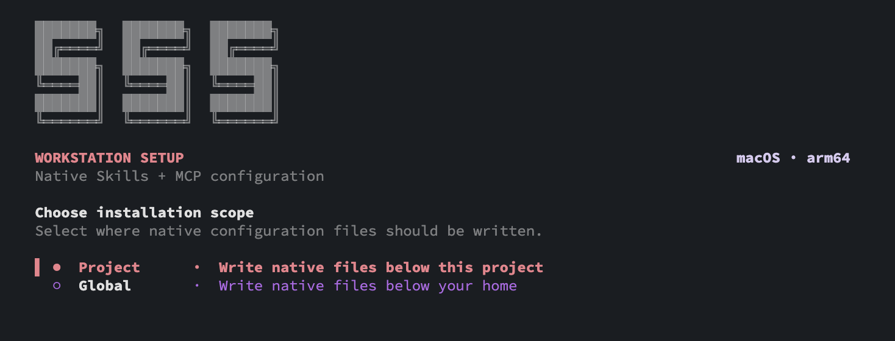
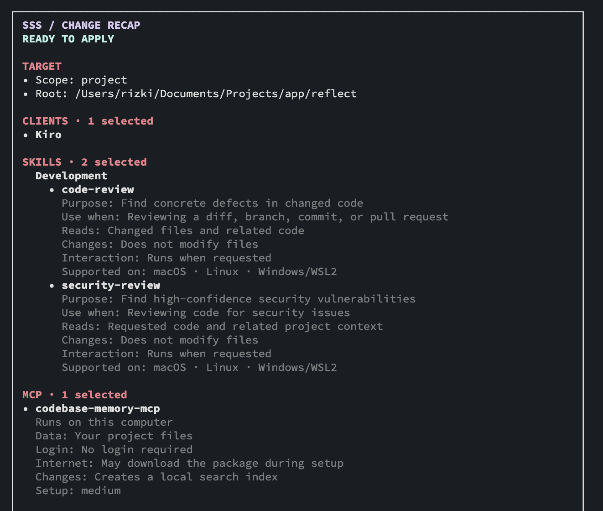
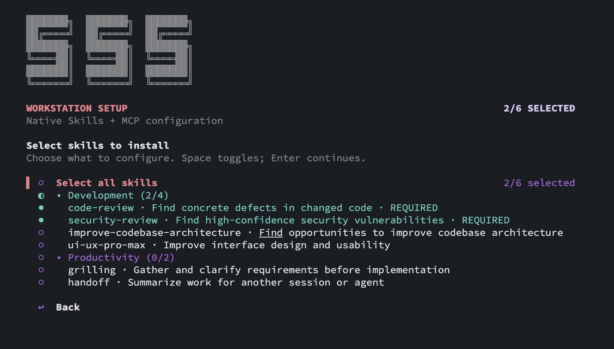
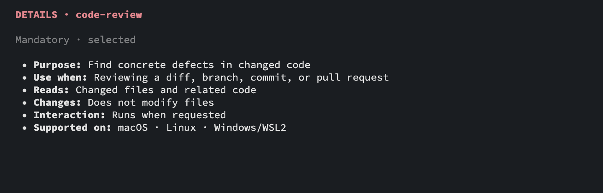

# SSS

Install native **Skills**, **MCP servers**, and project AI instructions for developer AI clients.

SSS writes client configuration files. It does not run MCP servers, manage credentials, or enforce runtime security.

## Start here

Run this from the project you want to configure:

```bash
cd /path/to/your/project
npx sss-ai-cli setup
```

Then:

1. Choose `Project` to configure the current project, or `Global` to configure your home directory.
2. Select `Skills`, `MCP servers`, and optional project `AI guardrails`.
3. Select the AI client(s) to configure.
4. Select the Skills and MCP servers.
5. Review the preview.
6. Confirm the changes.

`npx sss-ai-cli setup` is the recommended entrypoint. It opens the interactive menu and keeps the setup flow in one place.



*Choose where SSS should write native configuration files.*

## Requirements

You need:

- Python 3.9 or newer.
- Node.js and npm.
- Git for local development and Skills that inspect repository history.

The npm package includes its Python dependencies. You do not need a virtual environment or `pip install` for normal `npx` usage.

### Check your installation

```bash
python3 --version
node --version
npm --version
```

### Install on macOS

With Homebrew:

```bash
brew install python node
```

If Homebrew is not installed, use the official [Python installer](https://www.python.org/downloads/) and [Node.js LTS installer](https://nodejs.org/en/download).

### Install on Ubuntu or WSL2

```bash
sudo apt update
sudo apt install -y python3 python3-venv nodejs npm git
```

### Install on Windows

Install Python 3, Node.js LTS, and Git from their official installers. WSL2 users can follow the Ubuntu steps above.

## Preview before applying

To preview project changes without writing files:

```bash
npx sss-ai-cli setup --check
```

For an explicit non-interactive scope:

```bash
npx sss-ai-cli --scope project --project-root "$PWD" --check
```

`--check` never writes files.



*Review the selected clients, Skills, MCP servers, and planned changes before applying.*

## Apply changes directly

Project scope:

```bash
npx sss-ai-cli --scope project --project-root "$PWD"
```

Global scope:

```bash
npx sss-ai-cli --scope global
```

Without `--project-root`, project scope uses the current working directory. SSS does not automatically switch to the Git root.

## Update existing configuration

Existing Skills and MCP entries are skipped by default. To replace selected entries:

```bash
npx sss-ai-cli --scope project --project-root "$PWD" --update
```

`--force` is an alias for `--update`. Replaced files receive timestamped backups.

## Supported clients

| Client | Skills path | MCP config | Format |
| --- | --- | --- | --- |
| Kiro | `.kiro/skills` | `.kiro/settings/mcp.json` | JSON |
| Claude Code | `.claude/skills` | `.claude.json` | JSON |
| OpenCode | `.config/opencode/skills` | `.config/opencode/opencode.json` | JSON/JSONC |
| Antigravity IDE | `.gemini/config/skills` | `.gemini/config/mcp_config.json` | JSON |
| Codex | `.agents/skills` | `.codex/config.toml` | TOML |

Paths are relative to the selected scope root.

## Skills

Skills are copied into each selected client's native Skills directory.

`code-review` and `security-review` are currently mandatory when Skills are selected. Other Skills are optional.

The Skill picker shows a short purpose. Press `Tab` on a Skill to view its purpose, usage, file scope, behavior, supported platforms, and availability.



*Select Skills from the compact picker.*



*Press `Tab` to inspect the highlighted Skill before selecting it.*

## MCP servers

- `codebase-memory-mcp` runs as a local process through `npx`.
- Sentry and Jira entries use remote MCP URLs from `catalogue/mcp.yml`.
- SSS writes MCP configuration but does not authenticate, start, or verify provider connectivity.
- Self-hosted MCP endpoints must be configured for the target environment. Do not put credentials in the catalogue.

Press `Tab` on an MCP server to view its connection, data, login, network, and change details.

## AI guardrails

Project scope can create `AGENTS.md` in the selected project root.

`AGENTS.md` is an instruction contract for compatible AI clients. It is not a sandbox, access-control system, or runtime security policy.

SSS does not create a global `AGENTS.md` automatically.

## Useful commands

```bash
# Validate bundled catalogues and Skills
npx sss-ai-cli --validate

# Show all options
npx sss-ai-cli --help
```

If the npm wrapper cannot find Python, set `SSS_PYTHON`:

```bash
SSS_PYTHON=/path/to/python3 npx sss-ai-cli setup
```

## Optional: source development

This section is only for contributors working from a repository checkout. Normal users can skip it.

```bash
python3 -m venv .venv
.venv/bin/python -m pip install -r requirements.txt
.venv/bin/python -m unittest discover -s tests -v
.venv/bin/python -m cli --validate
.venv/bin/python -m cli --help
```

The legacy global bootstrap is also available from the repository:

```bash
npm run setup
```

## Safety and security

SSS protects local installation with path confinement, symlink checks, previews, conflict handling, backups, restricted permissions, `fsync`, and atomic replacement.

SSS does not provide a sandbox, MCP proxy, network policy, secret redaction, model routing, or runtime enforcement. See [`SECURITY.md`](SECURITY.md) for the full security boundary.

## Repository layout

```text
catalogue/   Skill and MCP catalogues
config/      Client paths and capabilities
skills/      Bundled Skill packages
cli/         Python CLI and deployment engine
bin/sss.js   npm/npx entrypoint
templates/   Generated project instruction templates
tests/       Automated checks
```
